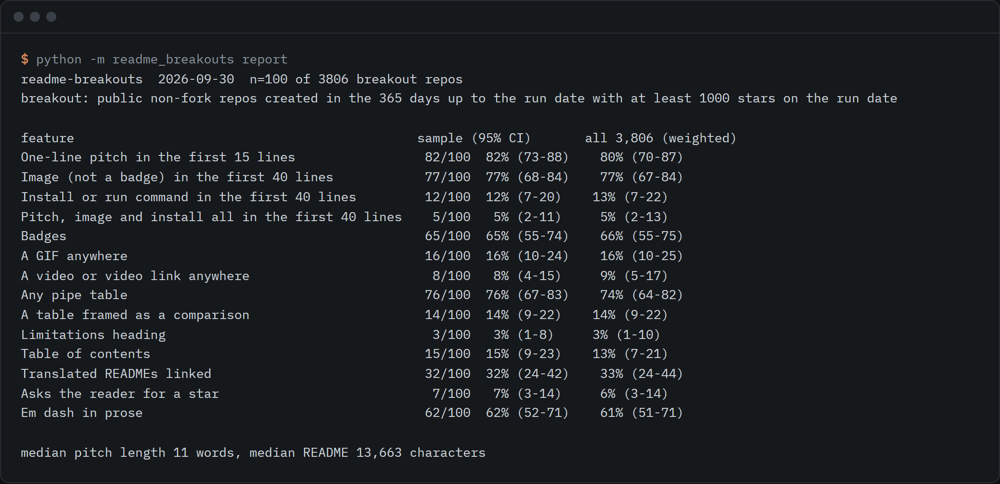

# readme-breakouts

An open dataset and method for what 100 breakout repos put in their READMEs.



```sh
git clone https://github.com/rishsadh/readme-breakouts && cd readme-breakouts
python -m readme_breakouts check path/to/README.md
```

`check` reads one README and shows, next to each feature, how many of the 100 sampled breakout READMEs have it. It needs Python 3.10 or newer and nothing else.

## Why this exists

GitHub restricted the stargazer list to repo admins and collaborators, in a change announced on 2026-06-30 ([changelog](https://github.blog/changelog/2026-06-30-upcoming-access-restrictions-to-public-api-endpoints-and-ui-views/)). The endpoint answered 404 when tried on 2026-09-30. Growth curves for other people's repos are now hard to get. README text is still public, so this study looks at that instead.

The question: among repos that broke out recently, what do the READMEs contain? "Breakout" here means a public, non-fork repo created in the 365 days up to 2026-09-30 with at least 1,000 stars that day. The search found 3,806 of them. The dataset is a stratified sample of 100, with every detector rule, hand check and limit written down in [METHOD.md](METHOD.md).

## What the sample shows

Population estimates, with 95% intervals. The plain sample shares are within four points of these. Full tables are in [REPORT.md](REPORT.md).

| Feature | Share of breakouts |
|---|---:|
| A one-line pitch in the first 15 lines | 80% (70 to 87) |
| A one-line pitch in the first 40 lines | 99% (92 to 100) |
| An image that is not a badge in the first 40 lines | 77% (67 to 84) |
| An image that is also not a logo or icon | 69% (59 to 77) |
| An install or run command in the first 40 lines | 13% (7 to 22) |
| An install or run command anywhere | 62% (52 to 72) |
| Pitch, image and install command all in the first 40 lines | 5% (2 to 13) |
| Badges | 66% (55 to 75) |
| A centered HTML header block | 65% (54 to 74) |
| A GIF anywhere | 16% (10 to 25) |
| A table framed as a comparison | 14% (9 to 22) |
| A limitations heading | 3% (1 to 10) |
| Translated READMEs linked | 33% (24 to 44) |
| An em dash in prose | 61% (51 to 71) |

Other facts from the run:

- The median README is 13,663 characters. The median pitch line is 11 words.
- Of the 14 READMEs with a comparison-framed table, 4 compare against tools outside the project. The rest compare the project's own editions or options.
- The sample was split into faster and slower climbers by stars per day. No feature differed once the 40 comparisons were corrected for. The smallest raw p-value was 0.033.
- 20 of the 100 READMEs are mostly Chinese. The heading and comparison rules match English words, so they undercount for those.

These are descriptions of one sample. They do not show that a feature causes stars.

## Use it

```sh
python -m readme_breakouts check README.md            # your README against the benchmark
python -m readme_breakouts check owner/repo           # fetch a README first (needs GITHUB_TOKEN or the gh CLI)
python -m readme_breakouts check README.md --json     # every feature, machine readable
python -m readme_breakouts features README.md         # the detectors' raw output
python -m readme_breakouts report                     # the headline table
python -m readme_breakouts report --markdown          # the full report
```

Repeat the study, or run it on a new date:

```sh
python -m readme_breakouts run                        # sample, fetch, analyze, report into data/<today>
python -m readme_breakouts sample --population data/2026-09-30/population.csv --dir data/redraw
```

`run` spaces API calls 3 seconds apart and waits 65 seconds after a 403 or 429. It reads through `GITHUB_TOKEN`, or through the `gh` command line if it is installed, and only ever calls read endpoints.

## The data

Everything is in `data/2026-09-30/`:

- `population.csv`: all 3,806 breakout repos with stars, forks, dates, stars per day, kind and licence. Repo descriptions are read during analysis (they feed the kind rule) but are not published.
- `sample.csv`: the draw of 100 (plus reserves), with the SHA of the README that was read.
- `features.csv`: what each detector found in each of the 100 READMEs.
- `summary.json`: shares, intervals, sizes, and the faster versus slower comparison.
- `hand-checks.csv`: the places where a detector disagreed with a human read.

The README texts themselves are not included, because they belong to their authors. The same goes for repo descriptions: the tool reads them to assign a kind and does not write them to any file.

## What it does not do

- It does not test for fake stars. The stargazer lists such a test needs are no longer public. A crude check that drops the 10 repos with the most stars per fork moved no share by more than 3.9 points, which is a weak signal only.
- It says nothing about cause. Faster and slower climbers did not differ on any feature after correction, in a sample this size.
- It is one sample of 100 from one day, weighted towards AI tooling because that is most of what broke out in these 12 months.
- The detectors read one line at a time and know package-manager style install commands only. Hand checks found about 93% of pitch flags, 80% of install flags and 4 of 14 comparison flags to be what they claim. The details are in METHOD.md.
- The kinds that set the sample weights come from crude keyword rules.

## Licence

MIT. By [@rishsadh](https://github.com/rishsadh).
